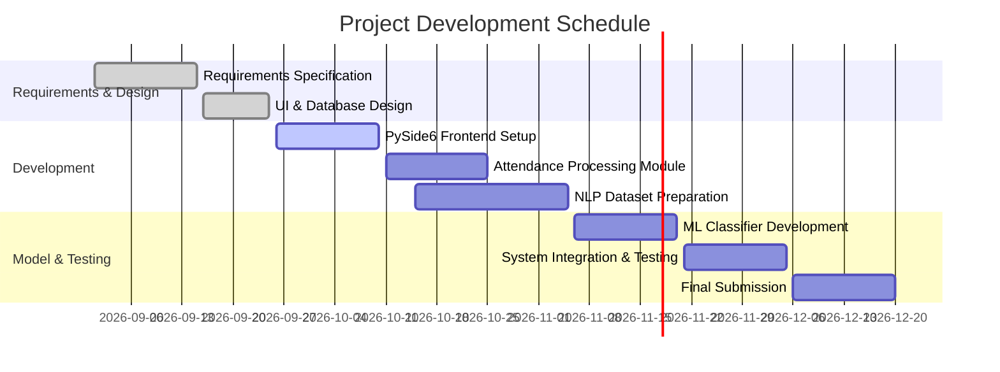

# SOFTWARE REQUIREMENTS SPECIFICATION (SRS)
## AI-BASED FACULTY ATTENDANCE, LEAVE & SUBSTITUTE MANAGEMENT ERP

**Document Standard:** IEEE SRS Format for Machine Learning Projects  
**Template Standard:** Department of MCA — Annexure B Reference Model  

---

### DOCUMENT CONTROL INFORMATION

* **Project Title:** AI-Based Faculty Attendance, Leave & Substitute Management ERP
* **Developer Name:** Shashank Poojary
* **Registration / USN:** `____________________`
* **Department:** Department of Master of Computer Applications (MCA)
* **Academic Period:** Batch 2025 – 2027
* **Project Supervisor:** `[ Guide Name ]`
* **Specification Version:** 1.0 (Simple & Original Academic Edition)
* **Submission Date:** October 2026

---

## TABLE OF CONTENTS

1. [Section 1: Introduction](#1-introduction)
   - 1.1 Purpose
   - 1.2 Intended Audience
   - 1.3 Scope
   - 1.4 References
2. [Section 2: Overall Description](#2-overall-description)
   - 2.1 Product Perspective
   - 2.2 Product Functions
   - 2.3 User Classes and Characteristics
   - 2.4 Operating Environment
   - 2.5 Design and Implementation Constraints
   - 2.6 Assumptions and Dependencies
3. [Section 3: Specific Requirements](#3-specific-requirements)
   - 3.1 Data Requirements
   - 3.2 Functional Requirements (System Features)
   - 3.3 Performance and ML Quality Requirements
   - 3.4 External Interface Requirements
   - 3.5 Security and Safety Requirements
4. [Section 4: Appendices](#4-appendices)
   - 4.1 Glossary of Terms
   - 4.2 Database Schemas
   - 4.3 Project Implementation Timeline

---

## 1. INTRODUCTION

### 1.1 Purpose
This Software Requirements Specification document details the functional and technical requirements for the **AI-Based Faculty Attendance, Leave & Substitute Management ERP**. The primary goal of this application is to assist academic departments in managing faculty biometric attendance logs, classifying natural language leave requests using machine learning algorithms, tracking grace minutes, and assigning substitute teachers without schedule overlaps.

By automating text classification and attendance calculations, the software reduces manual administrative work for Heads of Departments (HODs) and maintains accurate digital records.

### 1.2 Intended Audience
This specification is written for:
* **Academic Supervisors & Evaluators:** To assess system architecture and design completeness.
* **Software Developers & ML Engineers:** To build UI forms, database models, and text classification pipelines.
* **Department Administrators & Faculty:** To understand operational capabilities, user privileges, and workflow steps.

### 1.3 Scope
The system is built as a desktop application using **PySide6 (Python Qt6)** and a **MySQL relational database**.

#### Included Features:
1. **Biometric Log Ingestion:** Reading CSV or Excel files exported from biometric hardware to calculate total working hours and late minutes.
2. **Leave Reason Classification:** Using Natural Language Processing (NLP) to categorize plain text leave descriptions into 10 target academic leave types:
   * Casual Leave
   * Earned Leave
   * Academic Vacation Leave
   * Special Casual Leave
   * Medical Leave
   * Maternity Leave
   * Paternity Leave
   * On Duty Leave
   * Compensatory Leave
   * Restricted Leave
3. **ML Prediction Confidence:** Displaying a percentage confidence rating alongside recommended leave categories to assist HOD decision-making.
4. **Substitute Assignment:** Checking timetable availability within the department to suggest substitute faculty during approved leave periods.
5. **Grace Monitoring:** Tracking late arrival minutes against a configured monthly grace buffer.
6. **Attendance Anomaly Alerts:** Highlighting irregular absence trends or frequent grace usage.
7. **Role-Based Control:** Providing customized navigation interfaces for Admin, HOD, and Faculty roles.
8. **Report Generation:** Exporting attendance statistics, leave logs, and substitute allocations to PDF and Excel files.

#### Excluded Features:
* Real-time network socket streaming directly from physical biometric scanners.
* Support for non-English text input for leave application reasons.
* Web browser or mobile app interfaces.

### 1.4 References
1. IEEE Standard 830-1998 for Software Requirements Specifications.
2. Pedregosa et al. (2011), *Scikit-learn: Machine Learning in Python*, Journal of Machine Learning Research.
3. McCallum & Nigam (1998), *A Comparison of Event Models for Naive Bayes Text Classification*.
4. Official PySide6 / Qt6 Developer Documentation.
5. MySQL 8.0 Reference Guide.

---

## 2. OVERALL DESCRIPTION

### 2.1 Product Perspective
The system operates as an integrated desktop software application with a local database and embedded machine learning engine.

```text
+-----------------------------------------------------------------+
|                       PRESENTATION LAYER                        |
|                    PySide6 Desktop Application                  |
|        (Admin Controls  |  HOD Portal  |  Faculty Portal)       |
+--------------------------------+--------------------------------+
                                 |
+--------------------------------v--------------------------------+
|                         BUSINESS LOGIC                          |
|  +----------------------------+  +---------------------------+  |
|  | Biometric & Grace Processing|  | Substitute Scheduling     |  |
|  +----------------------------+  +---------------------------+  |
|  +----------------------------+  +---------------------------+  |
|  | Anomaly Identification     |  | PDF / Excel Report Engine |  |
|  +----------------------------+  +---------------------------+  |
+----------------+--------------------------------+---------------+
                 |                                |
+----------------v--------------+ +---------------+---------------+
|       NLP / ML PIPELINE       | |        DATABASE LAYER         |
|  (Scikit-Learn TF-IDF + MNB)  | |          MySQL 8.0            |
|  • Model Artifacts (.joblib)  | |  • Accounts & Role Tables    |
|  • Class Prediction Scoring   | |  • Attendance & Leave Tables |
+-------------------------------+ +-------------------------------+
```

Data flows from raw biometric punch files into the calculation service, while leave reason text is passed to the ML classifier model. All records persist in the MySQL database.

### 2.2 Product Functions
Main functional tasks performed by the ERP include:
* **Log Ingestion:** Parsing biometric punch records to compute daily check-in times, check-out times, and overall duration.
* **Grace Logic Calculation:** Comparing check-in timestamps against official department start times and deducting late minutes from monthly allowances.
* **Text Feature Extraction:** Converting raw reason strings into numerical TF-IDF feature vectors.
* **Leave Classification:** Scoring text against trained models (Multinomial Naive Bayes, Logistic Regression, SVM) and returning the highest-probability category.
* **Substitute Matching:** Recommending available department teachers who do not have teaching clashes on requested leave dates.
* **Outlier Detection:** Identifying unusual attendance habits such as frequent late arrivals on specific days.
* **User Authentication:** Enforcing role permissions across Admin, HOD, and Faculty views.

### 2.3 User Classes and Characteristics

| User Category | Description & Responsibilities | Privileges |
| :--- | :--- | :--- |
| **Admin** | Manages user accounts, configures shift timings, defines grace thresholds, retrains ML models, and backs up database tables. | Complete System Access |
| **HOD** | Reviews faculty leave applications, views ML confidence predictions, approves/rejects leaves, assigns substitutes, and inspects department attendance graphs. | Department Manager Access |
| **Faculty** | Submits leave requests with natural language reasons, views personal attendance records, checks grace usage, and monitors assigned substitute duties. | Personal User Access |

### 2.4 Operating Environment
* **Operating Systems:** Windows 10/11, Ubuntu Linux 20.04+, or macOS 12+.
* **Python Engine:** Python 3.10 or higher.
* **Database System:** MySQL Server 8.0 or MariaDB.
* **Hardware Requirements:**
  * CPU: Dual-core 2.0 GHz or better.
  * Memory: Minimum 4 GB RAM (8 GB recommended).
  * Storage: At least 1 GB free space.
* **Libraries:** `PySide6`, `scikit-learn`, `pandas`, `numpy`, `joblib`, `bcrypt`, `ReportLab`.

### 2.5 Design and Implementation Constraints
1. **Response Speed:** Machine learning predictions must execute in under 300 milliseconds.
2. **Model File Footprint:** Serialized model artifacts (`.joblib`) must stay below 30 MB.
3. **Data Security:** Passwords must be saved using salted `bcrypt` hashes, and database calls must use parameterized queries to block SQL injection.
4. **Interface Threading:** Data processing tasks must run on background threads (`QThread`) so the user interface remains responsive.

### 2.6 Assumptions and Dependencies
* Biometric CSV exports contain standard column titles: `Faculty_ID`, `Date`, `Punch_In`, and `Punch_Out`.
* Faculty members type clear English descriptions when explaining leave reasons.
* Department working rules and leave limits are defined before processing punch logs.

---

## 3. SPECIFIC REQUIREMENTS

### 3.1 Data Requirements

#### 3.1.1 Dataset Structure
* **Task Type:** Multi-class supervised text classification.
* **Target Categories (10 Classes):** Casual Leave, Earned Leave, Academic Vacation Leave, Special Casual Leave, Medical Leave, Maternity Leave, Paternity Leave, On Duty Leave, Compensatory Leave, Restricted Leave.
* **Input Attributes:**
  * `reason_text`: Plain text explanation entered by applicant.
  * `leave_category`: Ground truth category label.

#### 3.1.2 Preprocessing & Feature Extraction
1. **Cleaning:** Converting text to lowercase, stripping punctuation, and removing uninformative characters.
2. **Stopword Filtering:** Removing common non-essential English words.
3. **TF-IDF Transformation:** Converting words into TF-IDF numerical vectors using unigrams and bigrams with sublinear term scaling.

---

### 3.2 Functional Requirements

#### 3.2.1 Attendance Ingestion Module
* **REQ-ATT-1:** The application shall allow selecting and reading CSV or Excel biometric attendance files.
* **REQ-ATT-2:** The system shall calculate daily working hours from punch-in and punch-out values.
* **REQ-ATT-3:** The system shall calculate late check-in minutes based on the configured start time.
* **REQ-ATT-4:** The system shall deduct late minutes from the user's monthly grace allowance.

#### 3.2.2 NLP Leave Classification Module
* **REQ-NLP-1:** The system shall accept plain text reasons from the leave submission form.
* **REQ-NLP-2:** The application shall transform reason text using TF-IDF and pass it to the trained classifier.
* **REQ-NLP-3:** The system shall display the predicted leave category and its confidence score percentage on the approval interface.
* **REQ-NLP-4:** The system shall record both the user-selected category and predicted category in the database.

#### 3.2.3 Model Evaluation Module
* **REQ-ML-1:** Administrators shall be able to trigger model training on updated dataset files.
* **REQ-ML-2:** The system shall train and compare Multinomial Naive Bayes, Logistic Regression, and SVM algorithms.
* **REQ-ML-3:** The system shall output accuracy, precision, recall, and F1-score tables.
* **REQ-ML-4:** The system shall save the best performing model to disk for operational inference.

#### 3.2.4 Substitute Faculty Management
* **REQ-SUB-1:** The application shall display available departmental teachers during an applicant's leave dates.
* **REQ-SUB-2:** The system shall flag timetable conflicts to avoid double-assigning substitute teachers.
* **REQ-SUB-3:** The system shall log assigned substitute duties in the database upon approval.

#### 3.2.5 Reporting & Analytics
* **REQ-REP-1:** The system shall generate attendance and leave reports filterable by date and department.
* **REQ-REP-2:** The system shall export generated reports to PDF and Excel files.

---

### 3.3 Performance and ML Quality Requirements

#### 3.3.1 Target Accuracy Metrics
* **Minimum Model Accuracy:** The text classifier must achieve at least **80% accuracy** across test samples.
* **Minimum F1-Score:** The weighted F1-score must reach at least **0.80**.
* **Inference Speed:** Text prediction must return results within **300 milliseconds**.
* **Processing Throughput:** Reading and calculating 500 biometric punch rows must complete within **3 seconds**.

---

### 3.4 External Interface Requirements

#### 3.4.1 User Interface Windows (PySide6)
* **Login Window:** Screen for user authentication.
* **Attendance Log View:** Table showing punch times, status, and grace minutes.
* **Leave Application View:** Input form for selecting dates and entering reasons.
* **HOD Approval View:** Manager panel showing pending leaves with prediction confidence scores.
* **Substitute Allocation View:** Interface for checking teacher availability and assigning duties.
* **Model Training View:** Screen displaying classifier accuracy metrics and confusion matrices.
* **Report View:** Panel for generating and downloading PDF/Excel summaries.

#### 3.4.2 Software & Database Interfaces
* **Database Connection:** MySQL 8.0 accessed via standard SQL python connector using prepared queries.
* **PDF Engine:** `ReportLab` library for document generation.
* **Excel Engine:** `openpyxl` library for spreadsheet rendering.

---

### 3.5 Security Requirements

#### 3.5.1 Access Control & Data Protection
* User access is controlled strictly via role permissions (`ADMIN`, `HOD`, `FACULTY`).
* User passwords are hashed using salted `bcrypt`.
* Database queries use parameter binding to prevent SQL injection vulnerabilities.

---

## 4. APPENDICES

### 4.1 Glossary of Terms

| Term | Meaning |
| :--- | :--- |
| **ERP** | Enterprise Resource Planning — Integrated software used to manage core institutional operations. |
| **NLP** | Natural Language Processing — Techniques enabling computers to analyze human text. |
| **TF-IDF** | Term Frequency-Inverse Document Frequency — Numerical weighting reflecting word importance in a document. |
| **Grace Minutes** | Allowed monthly late arrival time buffer before attendance penalties apply. |
| **HOD** | Head of Department — Academic manager responsible for leave decisions. |

---

### 4.2 Database Schemas

```sql
-- Table: User Accounts
CREATE TABLE users (
    user_id INT AUTO_INCREMENT PRIMARY KEY,
    username VARCHAR(50) NOT NULL UNIQUE,
    password_hash VARCHAR(255) NOT NULL,
    user_role VARCHAR(20) NOT NULL,
    full_name VARCHAR(100) NOT NULL,
    department_name VARCHAR(50) NOT NULL
);

-- Table: Attendance Logs
CREATE TABLE attendance_records (
    record_id INT AUTO_INCREMENT PRIMARY KEY,
    user_id INT NOT NULL,
    log_date DATE NOT NULL,
    check_in TIME,
    check_out TIME,
    hours_worked DECIMAL(4,2),
    late_minutes INT DEFAULT 0,
    grace_minutes_used INT DEFAULT 0,
    attendance_status VARCHAR(20) NOT NULL,
    FOREIGN KEY (user_id) REFERENCES users(user_id)
);

-- Table: Leave Applications
CREATE TABLE leave_requests (
    request_id INT AUTO_INCREMENT PRIMARY KEY,
    user_id INT NOT NULL,
    start_date DATE NOT NULL,
    end_date DATE NOT NULL,
    reason_text TEXT NOT NULL,
    chosen_category VARCHAR(50),
    predicted_category VARCHAR(50),
    confidence_rate DECIMAL(5,2),
    substitute_user_id INT,
    approval_status VARCHAR(20) DEFAULT 'PENDING',
    FOREIGN KEY (user_id) REFERENCES users(user_id)
);
```

---

### 4.3 Project Implementation Timeline



---
*End of Specification Document.*
